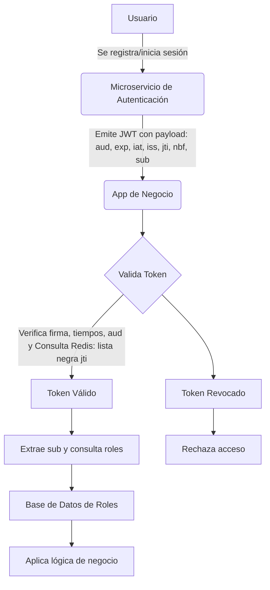

<p align="center">
  <a href="http://nestjs.com/" target="blank"></a>
</p>

[circleci-image]: https://img.shields.io/circleci/build/github/nestjs/nest/master?token=abc123def456
[circleci-url]: https://circleci.com/gh/nestjs/nest

  <p align="center">A progressive <a href="http://nodejs.org" target="_blank">Node.js</a> framework for building efficient and scalable server-side applications.</p>
    <p align="center">
<a href="https://www.npmjs.com/~nestjscore" target="_blank"></a>
<a href="https://www.npmjs.com/~nestjscore" target="_blank"></a>
<a href="https://www.npmjs.com/~nestjscore" target="_blank"></a>
<a href="https://circleci.com/gh/nestjs/nest" target="_blank"></a>
<a href="https://coveralls.io/github/nestjs/nest?branch=master" target="_blank"></a>
<a href="https://discord.gg/G7Qnnhy" target="_blank"></a>
<a href="https://opencollective.com/nest#backer" target="_blank"></a>
<a href="https://opencollective.com/nest#sponsor" target="_blank"></a>
  <a href="https://paypal.me/kamilmysliwiec" target="_blank"></a>
    <a href="https://opencollective.com/nest#sponsor"  target="_blank"></a>
  <a href="https://twitter.com/nestframework" target="_blank"></a>
</p>
  <!--[](https://opencollective.com/nest#backer)
  [](https://opencollective.com/nest#sponsor)-->


# Integración de la App de Negocio con el Microservicio de Autenticación

Esta documentación describe el flujo de integración entre el microservicio de autenticación y la aplicación de negocio. Se detalla cómo se utilizan los tokens JWT, la verificación de seguridad (incluyendo la comprobación en una lista de tokens revocados almacenada en Redis) y el manejo de roles dentro de la aplicación de negocio.

## Componentes Clave

- **Microservicio de Autenticación**
  - Emite tokens JWT al registrar o iniciar sesión.
  - Genera un payload con los siguientes campos:
    - `aud` (Audience): Destinatario del token.
    - `exp` (Expiration Time): Momento de expiración.
    - `iat` (Issued At): Momento en que se emitió.
    - `iss` (Issuer): Emisor del token.
    - `jti` (JWT ID): Identificador único para prevenir ataques de replay.
    - `nbf` (Not Before): Tiempo a partir del cual el token es válido.
    - `sub` (Subject): Identificador del usuario.

- **Aplicación de Negocio (Cliente)**
  - Recibe y utiliza el token para autenticar al usuario.
  - Verifica:
    - La firma y validez temporal del token (`iat`, `nbf` y `exp`).
    - Que el token esté destinado a ella (comprobación del `aud`).
    - Que el `jti` no figure en la lista de tokens revocados.
  - Usa el campo `sub` para identificar al usuario y, con ello, consultar la base de datos de roles y permisos para aplicar la lógica de negocio.

- **Lista de Tokens Revocados (Redis)**
  - Se utiliza para almacenar los `jti` de los tokens que han sido revocados (por ejemplo, tras un logout o cuando se detecta uso sospechoso).
  - La aplicación de negocio, o un microservicio dedicado, consulta Redis para confirmar que el token recibido no esté revocado.

## Flujo de Integración

1. **Autenticación y Emisión del Token**
   - El usuario se registra o inicia sesión en el microservicio de autenticación.
   - Se genera un token JWT que incluye los campos mencionados.
   - El token se envía a la aplicación de negocio.

2. **Validación del Token en la App de Negocio**
   - **Verificación de Firma y Tiempos:**
     La app valida la firma del token, comprueba que no haya expirado (`exp`), que se encuentre dentro de la ventana de validez (`iat` y `nbf`).
   - **Verificación del Destinatario:**
     Se comprueba que el `aud` del token coincida con la app de negocio.
   - **Verificación del Token Revocado:**
     La aplicación consulta el servicio (basado en Redis) para asegurarse de que el `jti` no esté en la lista negra.
   - **Identificación del Usuario:**
     Se extrae el `sub` para identificar al usuario y se consulta la base de datos local para obtener sus roles y permisos.

3. **Manejo de Roles y Permisos**
   - Con el identificador del usuario (`sub`), la aplicación de negocio consulta su propia base de datos para determinar los roles asignados.
   - Con base en los roles y permisos, la aplicación decide qué acciones puede realizar el usuario.

## Diagrama de Flujo

El siguiente diagrama ilustra la interacción entre los componentes:



<br>

# Arquitectura y Flujo de Validación Moderno

La arquitectura de este servicio está diseñada para desacoplar la **Autenticación (AuthN)** de la **Autorización (AuthZ)**. Este microservicio se encarga exclusivamente de verificar la identidad de un usuario y emitir un token JWT firmado con **RS256** (firma asimétrica). La responsabilidad de decidir *qué puede hacer* un usuario recae en los microservicios de negocio.

## Flujo de Validación Centralizado con API Gateway

Para una arquitectura robusta y escalable, se recomienda centralizar la validación de tokens en un **API Gateway** (por ejemplo, Traefik, Kong, etc.) en lugar de hacerlo en cada microservicio.

1.  **Recepción de la Petición:** El API Gateway es el único punto de entrada y recibe todas las peticiones de los clientes.
2.  **Validación del Token JWT:**
    *   El Gateway extrae el token JWT del header `Authorization`.
    *   Obtiene la clave pública del endpoint de este servicio (`/.well-known/jwks.json`) para verificar la firma del token. Este proceso es seguro y dinámico.
    *   Valida la firma, la expiración y otros `claims` del token.
3.  **Enrutamiento:** Si el token es válido, el Gateway reenvía la petición al microservicio de negocio correspondiente. Opcionalmente, puede enriquecer la petición con headers como `X-User-ID`.

Este enfoque libera a los servicios de negocio de la lógica de validación, reduce el acoplamiento y simplifica la gestión de la seguridad.

## Trazabilidad con IDs de Correlación

Para depurar y monitorear eficazmente un sistema de microservicios, es crucial implementar **IDs de Correlación**.

*   **¿Qué es?:** Un identificador único (ej. un UUID) que se asigna a cada petición que entra al sistema.
*   **¿Cómo funciona?:** El API Gateway debe generar este ID si no existe y añadirlo como un header HTTP (ej. `X-Correlation-ID`). Cada microservicio que procesa la petición debe leer este header, incluirlo en todos sus logs y **propagarlo** en cualquier llamada que haga a otros servicios.
*   **Beneficio:** Permite rastrear el ciclo de vida completo de una petición a través de múltiples servicios, simplificando enormemente la depuración y el análisis de errores.

## Endpoints Principales

Todos los endpoints están prefijados con `/api/v1`.

| Verbo  | Ruta                               | Descripción                                                                                                | Autenticación Requerida |
| :----- | :--------------------------------- | :--------------------------------------------------------------------------------------------------------- | :---------------------- |
| `POST` | `/auth/register`                   | Registra un nuevo usuario.                                                                                 | No                      |
| `POST` | `/auth/login`                      | Autentica a un usuario y devuelve un token JWT.                                                            | No                      |
| `POST` | `/auth/logout`                     | Invalida el token JWT actual añadiéndolo a una lista de revocación.                                         | Sí                      |
| `GET`  | `/auth`                            | Obtiene la lista de usuarios. Sirve para validar un token: si la petición es exitosa, el token es válido.   | Sí                      |
| `GET`  | `/.well-known/jwks.json`           | **(Ruta absoluta sin prefijo)** Expone la clave pública en formato JWKS para que clientes/gateways puedan verificar los tokens. | No                      |


## Description

[Nest](https://github.com/nestjs/nest) framework TypeScript starter repository.

## Installation

```bash
$ npm install
```

## Running the app

```bash
# development
$ npm run start

# watch mode
$ npm run start:dev

# production mode
$ npm run start:prod
```

## Test

```bash
# unit tests
$ npm run test

# e2e tests
$ npm run test:e2e

# test coverage
$ npm run test:cov
```

## ENV

Para Levantar el proyecto es necesario crear el archivo `.env` basado en `.env.example`:

```bash
cp .env.example .env
```

Para generar las claves RSA necesarias para JWT RS256:

```bash
openssl genrsa -out private.pem 2048
openssl rsa -in private.pem -pubout -out public.pem
```
